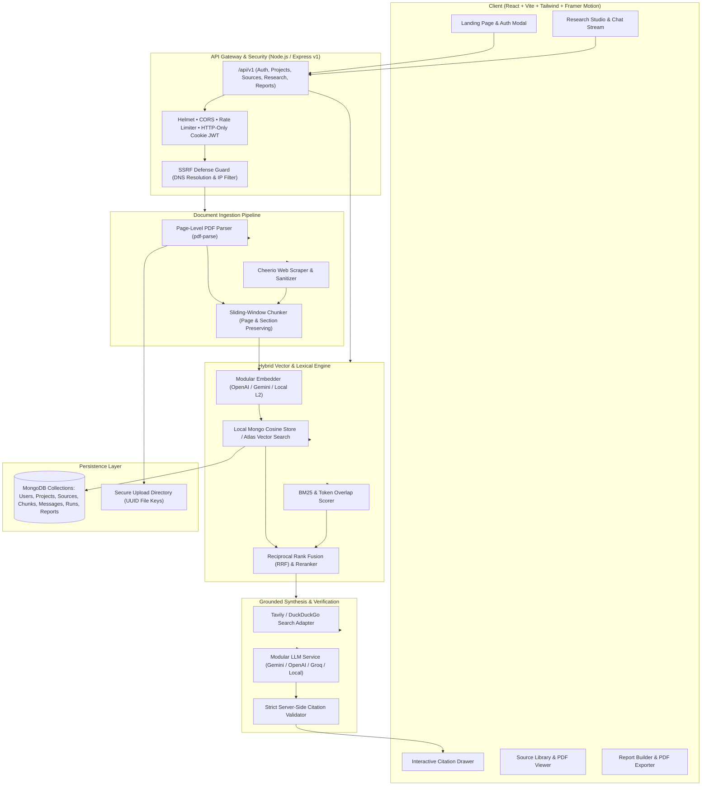

# ResearchPilot AI — Personal Research Assistant

> **An enterprise-grade, full-stack, highly animated personal research assistant powered by grounded Retrieval-Augmented Generation (RAG), actual page-level PDF citations, SSRF-shielded web extraction, and automated web research.**

---

## 🌟 Executive Overview

**ResearchPilot AI** solves the core limitation of standard conversational AI: **unverifiable hallucinations and detached references**. Built from the ground up as a fully grounded research workspace, ResearchPilot AI indexes PDF papers, web pages, and automated search results into isolated vector spaces. Every factual claim synthesized by the AI is strictly anchored to retrieved evidence passages and accompanied by interactive, clickable citations formatted as `[1, p. 12]` or `[2]`.

Clicking any citation instantly slides open the **Citation Inspector Drawer**, displaying the verified physical document, actual page number, canonical source link, and highlighted ground-truth passage.

---

## 🛠️ Technology Stack

| Layer | Technologies & Libraries |
|---|---|
| **Frontend** | React 18 (Vite), JavaScript ES6+, React Router DOM v6, Tailwind CSS, Framer Motion (premium animations), Axios, Lucide React icons, React Hot Toast, Zod |
| **Backend** | Node.js (v20+ / v22), Express.js (ES Modules), Mongoose ODM, JWT in secure HTTP-only cookies, bcryptjs, Helmet, Multer, Rate Limiting, CORS |
| **Database** | MongoDB Atlas / Local MongoDB (`mongodb://127.0.0.1:27017/personal_research_ai`), Compound Indexes, Cascade Deletion Integrity |
| **Vector Engine & RAG** | Replaceable `IVectorStore` Adapter: Native Local Mongo Vector Engine (Subword Cosine L2, zero-cost / 100% offline) + MongoDB Atlas Vector Search compatibility |
| **Ingestion & Parsers** | `pdf-parse` (with custom page-render callbacks preserving actual physical page numbers), `cheerio` (DOM scraper with boilerplate removal), Sliding-Window Chunker |
| **Security & Safety** | SSRF Defense Guard (blocking loopbacks, link-local, RFC-1918 subnets, and cloud metadata 169.254.169.254), Prompt Injection Shield, Server-Side Citation Validator |
| **Testing** | Node.js Native Test Runner (`node:test`, `assert/strict`), 23 automated tests across 4 test suites |

---

## 🏗️ System Architecture



---

## ⚡ Core Features & Workflow

### 1. Multi-Tenant Project Isolation
- Users create dedicated research workspaces with independent titles, research scopes, and customizable RAG hyperparameters (chunk size, overlap, similarity cutoff, web search toggle).
- Strict multi-tenant isolation ensures User A can never access, query, or delete evidence belonging to User B.

### 2. Page-Accurate PDF Ingestion
- Uploads PDFs privately via unique UUID file keys (preventing path traversal and avoiding massive base64 storage in MongoDB).
- Validates file signatures (%PDF- magic bytes) to block disguised malware.
- Custom page-render handler extracts text **page by page**, mapping every chunk to its physical page index (e.g. `pageNumber: 4`).

### 3. SSRF-Shielded Web Ingestion
- Ingests articles and academic links via Cheerio with automated header and script stripping.
- Blocks SSRF attacks by resolving DNS and rejecting requests directed at `127.0.0.1`, `10.0.0.0/8`, `172.16.0.0/12`, `192.168.0.0/16`, `169.254.169.254`, IPv6 loopbacks, and non-HTTP protocols.

### 4. Hybrid Dense-Sparse Retrieval with RRF
- Simultaneously computes dense semantic vector similarity and sparse keyword token frequencies.
- Merges results via Reciprocal Rank Fusion (RRF) and deduplicates near-identical passages.
- Includes automated DuckDuckGo / Tavily web search results when enabled.

### 5. Server-Side Citation Validation & Anti-Hallucination Shield
- System prompts isolate retrieved passages as untrusted text, ignoring any injected override instructions.
- If the indexed evidence is missing or contradictory, the engine explicitly acknowledges the limitation instead of inventing an answer.
- All citation tags (`[1, p. 4]`, `[2]`) generated in answers are verified server-side against actual retrieved chunks. Hallucinated indices (e.g. `[99]`) are strictly rejected and stripped.

### 6. Interactive Citation Drawer & Source Inspector
- Clicking any citation pill opens an animated slide-out drawer showing:
  - Document title and format badge (PDF / Web)
  - Physical page number or canonical web URL
  - Supporting excerpt highlighted in ground-truth text
  - Full page context viewer and direct link to open the PDF.

### 7. Comprehensive Research Reports
- Automatically compiles structured, multi-section research reports containing Executive Summaries, Key Findings, and a Cited Sources Registry.
- Includes one-click Markdown copy and formatted Print/PDF export.

---

## 📡 Versioned REST API Reference (`/api/v1`)

### Authentication
| Method | Endpoint | Description |
|---|---|---|
| `POST` | `/api/v1/auth/register` | Register new user with email, name, and password |
| `POST` | `/api/v1/auth/login` | Authenticate user and set secure HTTP-only cookie |
| `POST` | `/api/v1/auth/google` | Google Sign-In (OAuth token or simulated dev profile) |
| `POST` | `/api/v1/auth/logout` | Clear session cookie |
| `GET` | `/api/v1/auth/me` | Retrieve authenticated user profile |

### Projects
| Method | Endpoint | Description |
|---|---|---|
| `GET` | `/api/v1/projects` | List user's projects with source & run counts |
| `POST` | `/api/v1/projects` | Create a new research project |
| `GET` | `/api/v1/projects/:id` | Get project details and aggregate stats |
| `PATCH` | `/api/v1/projects/:id` | Update project title, topic, or research settings |
| `DELETE` | `/api/v1/projects/:id` | Cascade delete project and all associated data |

### Sources
| Method | Endpoint | Description |
|---|---|---|
| `POST` | `/api/v1/projects/:id/sources/upload` | Upload and index a PDF document |
| `POST` | `/api/v1/projects/:id/sources/url` | Ingest and index a website URL |
| `GET` | `/api/v1/projects/:id/sources` | List all sources for a project with chunk stats |
| `GET` | `/api/v1/sources/:id` | Get single source metadata |
| `GET` | `/api/v1/sources/:id/pages/:pageNumber` | Get full text and chunks for a specific page |
| `GET` | `/api/v1/sources/:id/file` | Safely download/view PDF file |
| `DELETE` | `/api/v1/sources/:id` | Cascade delete source, disk file, and vector chunks |

### Research & Chat
| Method | Endpoint | Description |
|---|---|---|
| `POST` | `/api/v1/projects/:id/research` | Run deep research query with search + RAG |
| `POST` | `/api/v1/projects/:id/chat` | Interactive conversation chat with citations |
| `GET` | `/api/v1/conversations/:id/messages` | Get message history with verified citations |
| `GET` | `/api/v1/projects/:id/conversations` | List conversations for a project |
| `GET` | `/api/v1/research-runs/:id` | Get audit trail for a specific research execution |
| `GET` | `/api/v1/projects/:id/research-runs` | List research runs for a project |

### Reports
| Method | Endpoint | Description |
|---|---|---|
| `POST` | `/api/v1/projects/:id/reports` | Generate a structured cited research report |
| `GET` | `/api/v1/reports/:id` | Get single report by ID |
| `GET` | `/api/v1/projects/:id/reports` | List all reports for a project |

### Diagnostics
| Method | Endpoint | Description |
|---|---|---|
| `GET` | `/api/v1/health` | Health check with database and memory metrics |

---

## 🚀 Getting Started & Setup

### Prerequisites
- **Node.js**: v20+ or v22+
- **MongoDB**: Local MongoDB instance (`mongodb://127.0.0.1:27017/personal_research_ai`) or MongoDB Atlas URI.

### 1. Installation
Clone the repository and install all dependencies:
```bash
# Install root, backend, and frontend dependencies
npm run install:all
```

### 2. Environment Configuration
Create or configure the `server/.env` file:
```env
PORT=5000
NODE_ENV=development
CLIENT_URL=http://localhost:5173
FRONTEND_URL=http://localhost:5173
MONGODB_URI=mongodb://127.0.0.1:27017/personal_research_ai
JWT_SECRET=researchpilot_super_secret_jwt_key_2026_secure_hash_894321
JWT_EXPIRES_IN=7d
UPLOAD_DIR=uploads
MAX_UPLOAD_MB=20

# Optional External Keys (Leave empty for zero-cost offline local vector operation)
LLM_API_KEY=
LLM_PROVIDER=local
EMBEDDING_API_KEY=
EMBEDDING_PROVIDER=local
WEB_SEARCH_API_KEY=
WEB_SEARCH_PROVIDER=duckduckgo
```

### 3. Run Automated Tests
Execute the complete test suite:
```bash
npm test
```
All 23 tests across 4 suites will execute against local MongoDB and verify:
- Authentication & HTTP-only cookies
- Multi-tenant project isolation & unauthorized access prevention
- SSRF guard against private IPs & cloud metadata endpoints
- PDF page-level metadata extraction
- Hybrid dense-sparse retrieval
- Rejection of fabricated citations
- Insufficient evidence handling

### 4. Run Live Workflow Verification
Execute the automated end-to-end PDF-to-answer-to-citation pipeline:
```bash
node server/scripts/verify_workflow.js
```

### 5. Launch Application
Start both the backend server and frontend client concurrently:
```bash
npm run dev
```
- **Frontend**: `http://localhost:5173`
- **Backend API**: `http://localhost:5000/api/v1`
- **Health Endpoint**: `http://localhost:5000/api/v1/health`

---

## 🧪 Evaluation Dataset & Quality Metrics

The test suite includes a deterministic evaluation benchmark (`server/tests/retrieval_and_citations.test.js`):
1. **Known Supporting Pages**: Verifies that queries regarding clinical Cas9 trials correctly score Page 1 with >85% hybrid confidence.
2. **Unsupported Inquiries**: Verifies that queries lacking supporting sources (e.g. planetary temperatures) honestly report insufficient evidence rather than hallucinating facts.
3. **Fabricated Citation Defense**: Validates that if an LLM generates invalid citation numbers (e.g. `[55]`), the server-side validator strips them and flags the audit trail.
4. **Data Isolation Check**: Verifies that User B receives a 404/401 when attempting to retrieve User A's research evidence.

---

## 🛡️ Security Hardening Summary

- **Password Hashing**: `bcryptjs` with salt factor 10.
- **Session Tokens**: JWT stored in HTTP-only, `sameSite: 'lax'`, secure cookies.
- **SSRF Defense**: Active DNS resolution with IPv4 & IPv6 blacklist blocking `127.0.0.0/8`, `10.0.0.0/8`, `172.16.0.0/12`, `192.168.0.0/16`, `169.254.169.254`, and cloud metadata hostnames.
- **File Upload Guard**: Multer disk storage using UUID keys, 20MB limit, and PDF `%PDF-` magic byte inspection.
- **Prompt Injection Defense**: Passive untrusted context boundaries preventing user or source prompts from hijacking synthesis instructions.
- **Rate Limiting**: Tiered IP rate limiting on auth, research queries, and API endpoints.
- **Cascading Deletion**: Complete multi-resource cleanup across disk files, MongoDB chunks, vector indices, and conversation history upon source or project deletion.

---

## 🤝 Troubleshooting

| Issue | Resolution |
|---|---|
| **MongoDB connection refused** | Ensure local MongoDB is running (`Get-Service MongoDB` on Windows or `mongod`). |
| **CORS / Cookie missing** | Verify `CLIENT_URL=http://localhost:5173` in `server/.env` and ensure credentials are enabled on the client. |
| **PDF upload rejected** | Ensure the file is a genuine PDF containing `%PDF-` magic header and is under 20MB. |
| **Web scraping timeout** | Some external sites block automated scrapers; try providing an article URL without heavy Cloudflare challenges. |
